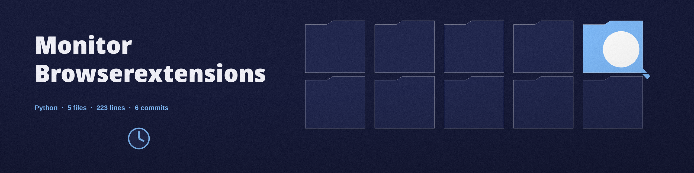

# monitor-browserextensions
Monitors the installation, removal, and modification of browser extensions across different browsers. - Focused on System monitoring and alerts

The tool uses only the Python standard library, so there is nothing to install.

## What is monitored

- Chrome: the monitored state holds one entry per installed version of each extension, with the modification time of its `manifest.json` when one is present. A new version folder or a changed manifest inside an installed extension changes the state and is reported, not only the arrival or removal of a top level extension ID folder.
- Firefox: `extensions.json` in each profile is parsed, and the addons inside it are monitored by profile, addon ID, and version. Every folder under the profiles directory is treated as a profile, whatever its name suffix, and a single profile directory can also be given directly.

Default directories are chosen by `sys.platform`, with the macOS (`darwin`) paths selected on macOS.

`--extensions_dir` can be used on its own, without `--browser`: the format is then inferred from the directory itself (a directory holding `extensions.json`, directly or inside profile folders, is read as Firefox; anything else is read as Chrome).

## Coverage

At startup the monitor logs a coverage statement naming the extensions directory, whether it could be read, and how many extension states were found. If the resolved extensions directory does not exist or cannot be read at startup, that is reported as a directory that could not be read, distinctly from a directory that was read and found empty, and the tool exits 1 instead of monitoring an empty set forever. A directory that was read and is genuinely empty is monitored normally. If the directory becomes unreadable during monitoring, the cycle's coverage line says so and the previous state is kept, rather than the directory being treated as empty.

## Install
`git clone https://github.com/ShadowGuardAI/monitor-browserextensions`

## Usage
`python3 main.py [--browser {chrome,firefox}] [--extensions_dir DIR] [--interval SECONDS] [--report FILE] [--alert-on-change]`

Either `--browser` or `--extensions_dir` (or both) must be given.

## Parameters
- `-h`: Show help message and exit
- `--browser`: The browser to monitor (chrome or firefox).
- `--interval`: The interval (in seconds) between checks. Must be a positive integer.
- `--report`: File to save extension change reports.
- `--alert-on-change`: Alert and log on extension change
- `--extensions_dir`: Specify the extensions directory. Can be used without `--browser`; the format is inferred from the directory.

## License
Copyright (c) ShadowGuardAI
